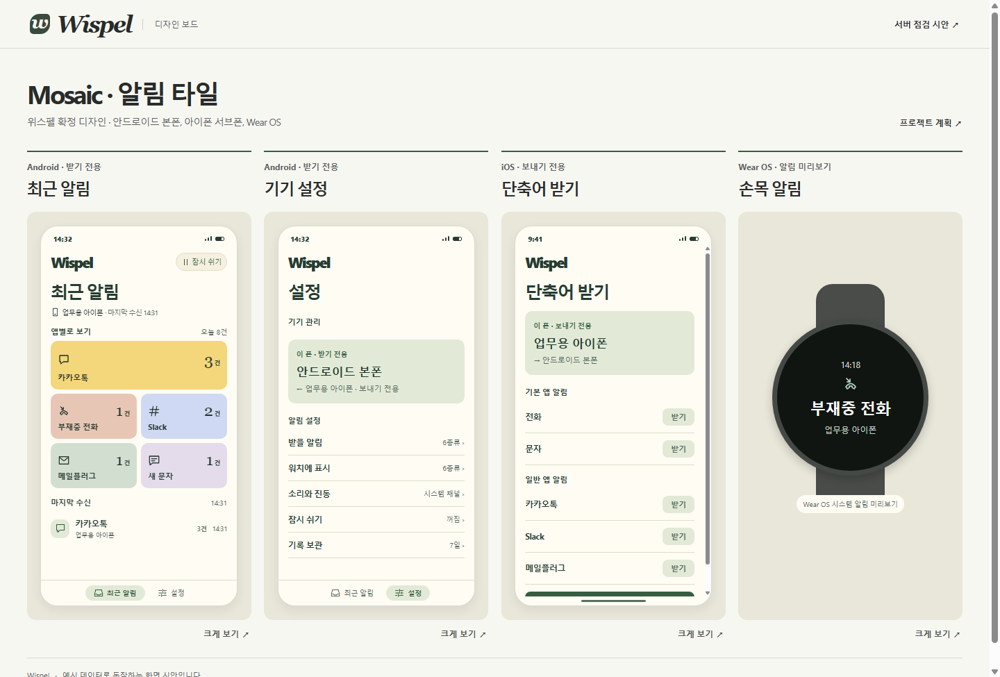

# Wispel · 위스펠

아이폰과 안드로이드 사이에 알림의 **기기명과 종류**를 전달합니다. 지원 종류는 전화, 부재중 전화, 문자, 카카오톡, Slack, 메일플러그입니다. 각 폰에서 보내기 전용 또는 받기 전용을 선택하고, 수신 본폰은 한 대를 사용합니다.

| 구성 | 구현 |
|---|---|
| [Windows 서버](windows-server/) | C#·ASP.NET Core·SQLite. QR 등록, HTTPS 접수, Android WebSocket, iOS APNs, 서비스와 별도 로컬 점검 웹 |
| [안드로이드 폰](android-phone/) | Kotlin·Compose. 직접 수신, 시스템 알림·종류별 워치 전달, 알림 접근 기반 발신 |
| [아이폰](ios-phone/) | Swift·SwiftUI·App Intents. 서명된 앱별 단축어 5개, 발송 대기열, APNs 수신 |
| [Wear OS](android-wear/) | 페어링된 안드로이드 본폰의 시스템 알림 브리징 |

## Windows에서 시작하기

.NET 10 SDK로 빌드합니다. 아래 IP는 이 프로젝트의 LAN 시험에 사용한 Windows 주소입니다. 폰에서도 도달 가능한 Windows 인터페이스 주소를 사용하세요.

```powershell
dotnet publish windows-server/Wispel.csproj -c Release -r win-x64 --self-contained true -o artifacts/windows-server
.\windows-server\Install-Wispel.ps1 -PublishDirectory artifacts/windows-server -Address 192.168.0.7
$wispelExe = Join-Path $env:ProgramFiles 'Wispel/Wispel.exe'
$wispelData = Join-Path $env:ProgramData 'Wispel'
& $wispelExe pair receive receiver.png --home $wispelData
& $wispelExe pair send sender.png --home $wispelData
& $wispelExe diag --home $wispelData
```

설치 명령은 관리자 PowerShell에서 실행합니다. 클라이언트 경로의 TCP 7443 접근을 준비하세요. 점검 웹 주소는 마지막 명령이 콘솔에 출력합니다. QR은 5분간 유효하며 한 번 사용할 수 있습니다. 재발급할 때는 `pair`를 다시 실행합니다. QR·서버 PFX·Apple 키는 비밀로 보관하세요. 서비스 등록 없이 시험하려면 같은 실행 파일의 `init IP PORT --home 폴더`, `serve --home 폴더`를 사용합니다.

## 두 폰 등록하기

집 밖에서 쓸 주소가 Windows의 LAN 주소와 다르면 설치 시 `-Address`에 Windows가 수신할 로컬 IP를, `-AdvertisedAddress`에 폰이 접속할 IP를 지정합니다. 설치 도구가 접속 IP에 맞춰 인증서와 QR을 만듭니다. VPN이나 포트 전달 경로는 사용하는 네트워크에서 설정합니다.

1. Android SDK 35와 JDK 17을 준비한 뒤 `android-phone`에서 `.\gradlew.bat assembleDebug`를 실행합니다. `adb install -r app/build/outputs/apk/debug/app-debug.apk`로 본폰에 설치합니다. 받기 QR을 스캔하고 **직접 수신 켜기**를 선택합니다. 직접 수신이 켜져 있는 동안 본폰에 연결 상태 알림이 표시됩니다.
2. Mac에서 `ios-phone/Wispel.xcodeproj`의 Wispel 스킴을 엽니다. 시뮬레이터로 실행하거나, 실기기는 Xcode에서 기기·서명 팀을 선택합니다. 아이폰에서 보내기 QR을 스캔하고 **시험 알림 보내기**를 누릅니다.
3. 아이폰의 **단축어 받기**에서 앱별 서명 파일을 가져옵니다. 해당 앱의 알림 자동화에 **단축어 실행** 동작을 추가하고 가져온 단축어를 선택합니다. 기존 자동화에는 **위스펠로 알림 전달** 동작을 직접 넣을 수도 있습니다. 전화 자동화에서는 알림 텍스트를 입력으로 넘깁니다. 셀룰러에서 집 서버에 닿으려면 외부 접근 가능한 IP 또는 VPN을 구성하고 그 주소에 맞는 인증서·QR로 등록해야 합니다.
4. 역방향에서는 Android를 보내기 전용으로 등록하고 시스템의 위스펠 알림 접근을 켭니다. 아이폰은 받기 전용으로 등록해 알림을 허용합니다. Apple 개발 팀의 푸시 권한, 앱 번들 ID에 대응하는 APNs 공급자 키와 iOS 서명이 필요합니다. 서비스 프로세스에 `WISPEL_APNS_KEY`(p8 파일 경로), `WISPEL_APNS_KEY_ID`, `WISPEL_APNS_TEAM`, `WISPEL_APNS_TOPIC`을 설정합니다. 기본 대상은 Apple 샌드박스입니다. 배포 서명에서는 앱의 `APS_ENVIRONMENT`를 production으로, Windows의 `WISPEL_APNS_PRODUCTION`을 1로 설정합니다. 키는 서비스 계정만 읽을 수 있는 위치에 둡니다.

## 계획·디자인·검증

[개발 계획](plan.md) · [전달 규약](planning/protocol.md) · [테스트 재현](qa/README.md) · [시험 결과](planning/verification.md)



[동작하는 디자인 보드](design/index.html) · [점검 웹 시안](design/diagnostics.html) · [아이콘 후보](design/icons/index.html)
